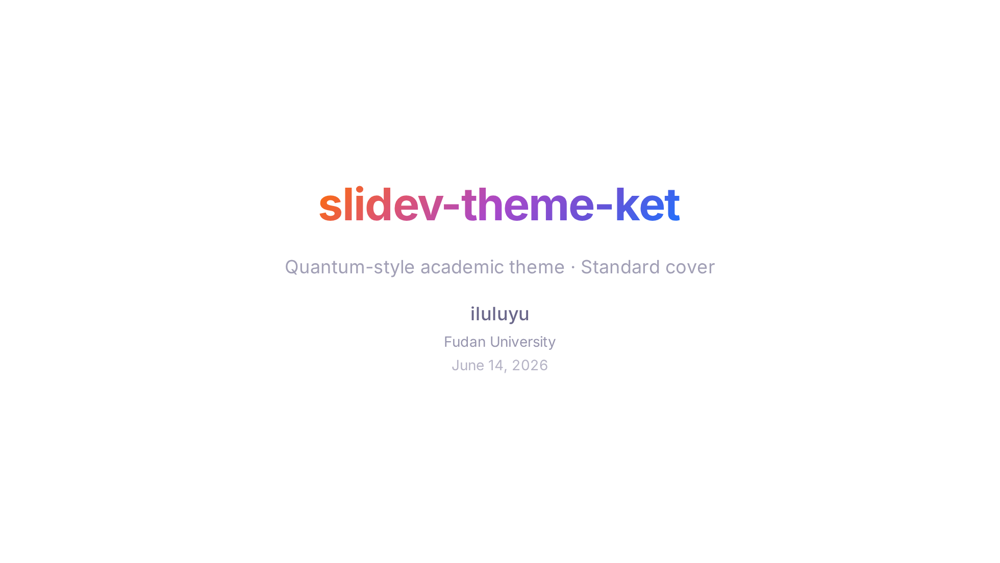
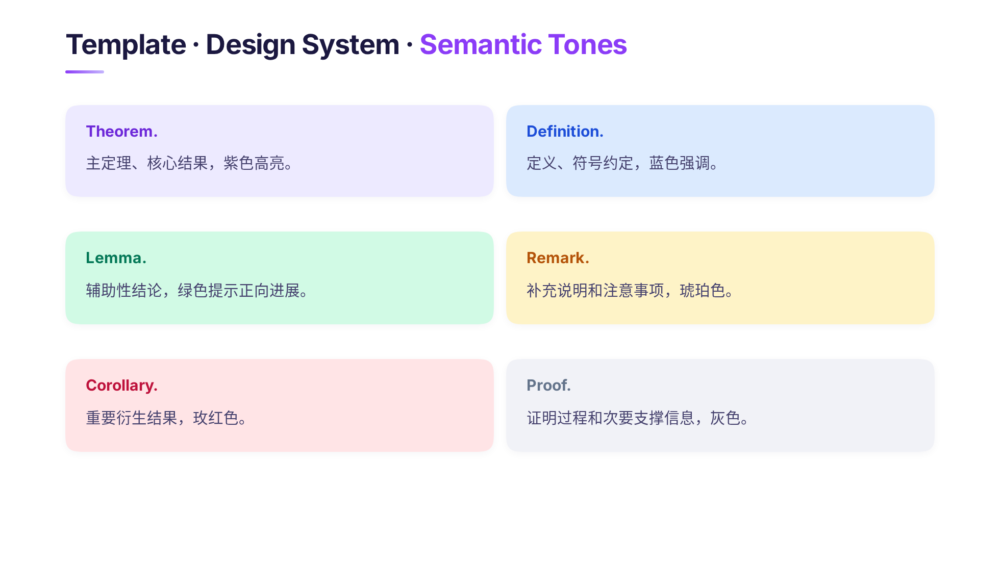

# slidev-theme-ket

[](https://www.npmjs.com/package/slidev-theme-ket)

An academic theme for [Slidev](https://sli.dev) — built for talks with theorems,
definitions, and math.



## Highlights

- `Pad` theorem / definition / note blocks with semantic tones
- Five cover variants: `cover`, `cover-deco`, cosmic `cover-cosmic` (Three.js black hole), centered `PaperCover`, deco `PaperCover`
- `Figure` component for referenced images with Markdown captions
- `XCard` / `XFan` — tweet-style evidence cards that fan out with click reveals
- Emphasis utilities: `kw-*` keyword tones, `claim`, `lead-slot` (dark-mode ready)
- Layouts for every talk beat: cover, section, two-column, thanks
- Two switchable palettes — calm `mono` (default) and the original `vivid` look — via `themeConfig.palette`, both dark-mode ready
- Geist typography, self-hosted (no runtime font requests)

## Preview locally

```bash
pnpm install
pnpm dev      # → http://localhost:3030
```

`pnpm build` renders the showcase; `pnpm screenshot` captures the first slide.

## Use in a deck

```yaml
---
theme: ket
---
```

For local development, point at this directory:

```yaml
---
theme: ../../slidev-theme-ket
---
```

### Palette

Two color palettes ship in the theme, switched globally from deck headmatter:

```yaml
---
theme: ../../slidev-theme-ket
themeConfig:
  palette: mono    # default — may be omitted; `vivid` restores the original colors
---
```

- `mono` (default) — neutral gray surfaces with a single indigo focus color;
  merged from the retired `slidev-theme-ket-mono` variant; its separate
  submodule has been removed.
- `vivid` — the original ket look: parchment ground, deep indigo text,
  quantum-violet accent.

The switch is deck-global (no per-slide palette) and recolors tokens only —
layout sizes and the component API are identical; light and dark mode are
both supported.

Migrating older decks:

- On `slidev-theme-ket-mono`: point `theme:` at `../../slidev-theme-ket` —
  the mono look is the default now.
- Wanting the previous violet look: set `palette: vivid`.
- Still using `<Bra …>` tags: rename them to `<Pad …>` — the theorem block
  component is `Pad` only.

## Design system

Ket spends color deliberately: neutral surfaces carry the hierarchy, one
focus color marks emphasis, and semantic color appears only when it carries
meaning — each `Pad` tone maps to a role. The default `mono` palette:



| Token | mono (default) | Role |
| --- | --- | --- |
| `--ket-ac` | `#5856D6` | Indigo focus accent |
| `--ket-t1` | `#1D1D1F` | Primary text |
| `--ket-t2` | `#424245` | Body text |
| `--ket-t3` | `#6E6E73` | Captions |

`palette: vivid` restores the original violet ramp (`--ket-ac: #7229E8`,
`--ket-t1: #1B1840`, …).

Full tables for both palettes, both modes, and the global chrome:
[docs/design-tokens.md](./docs/design-tokens.md).

## Components

### `Pad`

Academic theorem and note block (formerly `Bra`; older decks must rename
their tags).

```vue
<Pad type="theorem" name="No-Cloning" :number="1">

There is no unitary $U$ that clones every state $|\psi\rangle$.

</Pad>
```

Common props:

- `type`: `theorem`, `lemma`, `proof`, `definition`, `corollary`, `question`, `assumption`, `protocol`
- `title`, `name`, `number`
- `tone`: `default`, `primary`, `success`, `warning`, `danger`, `muted`
- `compact`, `border`, `italic`
- `color`, `bg-color`, `title-color`, `border-color`

### `PaperCover`

Academic paper cover — title, authors, affiliations, optional decoration.

```vue
<PaperCover
  deco
  title="Exponential Speedup in Measurement Property Learning"
  :authors="[['Z. Liu', '1'], ['Q. Ye', '1,2']]"
  :affiliations="[['1', 'Tsinghua University'], ['2', 'Shanghai Qi Zhi']]"
/>
```

### `Figure`

Referenced image with a figure number and Markdown caption.

```vue
<Figure src="/figures/bloch-sphere.svg" :number="1" width="70%">

**Bloch sphere** — pure states $|\psi\rangle$ lie on the unit sphere.

</Figure>
```

Full props, the `type → tone` map, and compatibility notes: [docs/components.md](./docs/components.md).

## Layouts

| Layout | Purpose |
| --- | --- |
| `cover` | Centered title with presenter metadata |
| `cover-deco` | Left-aligned title with orbit / custom decoration |
| `intro` | Quiet centered interlude |
| `section` | Numbered section divider with tags |
| `default` | Standard content slide |
| `two-cols-header` | Full-width heading above two adjustable columns |
| `thanks` | Closing slide |

Useful frontmatter:

- `gradient: true` — gradient title fill
- `tag` — eyebrow label on `cover-deco`
- `sectionNumber` / `tags` — on `section`
- `cols` — column ratio on `two-cols-header`
- `hideFooter: true` — hide the page counter

Full usage and slots: [docs/layouts.md](./docs/layouts.md).

## License

[MIT](./LICENSE)
